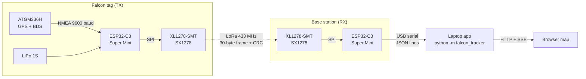
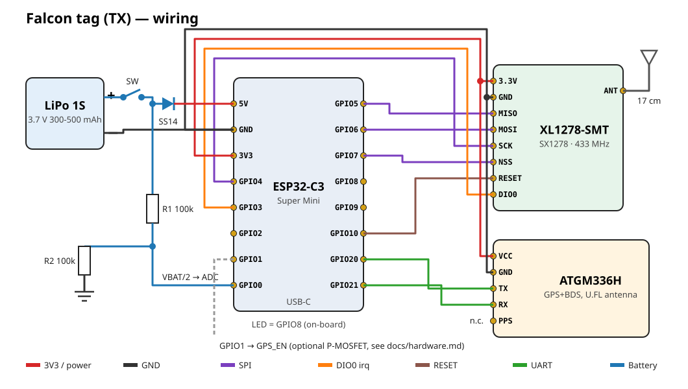
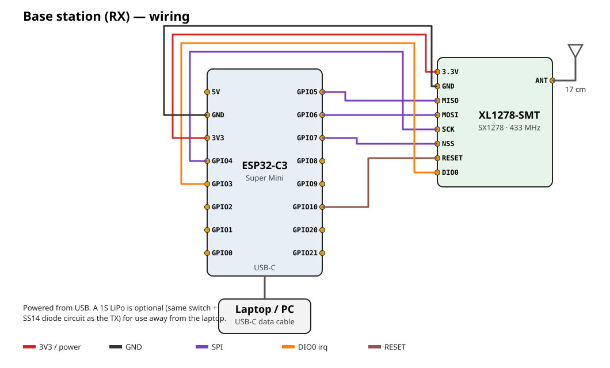

# Falcon Tracker

**Open-source LoRa GPS tracker for falconry.** A tiny tag on the falcon reads its
position from a GPS+BeiDou receiver and sends it over 433 MHz LoRa. A base station
plugged into a laptop receives it and shows every bird live on a map, with track
history, distance and bearing from you, battery level and signal strength.

No internet, SIM card or subscription is needed for the radio link. (The map
tiles need internet the first time you view an area.)

[Bahasa Indonesia](README.id.md) · [Hardware](docs/hardware.md) · [Firmware](docs/firmware.md) ·
[App](docs/app.md) · [Protocol](docs/protocol.md) · [Architecture](docs/architecture.md) ·
[Troubleshooting](docs/troubleshooting.md)



## Features

- **Web dashboard** in the same style as the author's other projects: status card (TRACKING / NO GPS FIX / LOW BATTERY / SIGNAL LOST), live map, battery, speed, altitude and signal charts, serial monitor, settings, guide.
- **Live map** with satellite and street layers, one colour per falcon, heading arrow, track line.
- **Distance and bearing** from the base station to each bird, plus a one-click "Navigate" link.
- **Multiple falcons** on one receiver (each tag has its own `DEVICE_ID`).
- **Lost-bird mode**: when the GPS loses its fix the tag keeps transmitting its last known position and battery, flagged as stale.
- **Low power**: radio sleeps between packets, the MCU light-sleeps, and an optional MOSFET switches the GPS off for long intervals.
- **Robust link**: SF9 LoRa with hardware CRC plus our own CRC-16, a fixed 30-byte binary frame (~280 ms on air).
- **Logs everything** to CSV and exports GPX tracks for Google Earth, QGIS, Strava and friends.
- **Lost-bird alarm**: optional beep when no packet arrives for a time you choose.
- **Demo mode** that simulates two falcons, so you can try the app with no hardware.
- **Tested**: protocol unit tests (C) and app tests (Python) run in CI on every push.

## Hardware at a glance

| | Falcon tag (TX) | Base station (RX) |
|---|---|---|
| MCU | ESP32-C3 Super Mini (+ expansion board for prototyping) | ESP32-C3 Super Mini (+ expansion board) |
| Radio | XL1278-SMT (SX1278, 433 MHz) + 17 cm antenna | XL1278-SMT (SX1278, 433 MHz) + antenna |
| GNSS | ATGM336H GPS+BDS module + active patch antenna (U.FL) | – |
| Power | 1S LiPo 300–500 mAh, switch, SS14 diode | USB from the laptop (LiPo optional) |

| TX wiring | RX wiring |
|---|---|
|  |  |

Full pin tables, bill of materials, power budget and mounting notes are in
[docs/hardware.md](docs/hardware.md).

## Quick start

### 1. Try the app with no hardware

```bash
cd app
python -m pip install -e .
python -m falcon_tracker --demo
```

Your browser opens at <http://localhost:8000> with two simulated falcons.
On Windows you can also double-click `START_DEMO.bat` (or `START_DASHBOARD.bat` for the real thing).

### 2. Flash the boards

Install [PlatformIO](https://platformio.org/install) (the VS Code extension or `pip install platformio`), then:

```bash
cd firmware
pio run -e tx -t upload      # falcon tag
pio run -e rx -t upload      # base station
pio device monitor           # optional: watch the log at 115200 baud
```

Give every falcon tag its own id: change `-D DEVICE_ID=1` in `platformio.ini` before flashing the next tag.

### 3. Track

Plug the base station into the laptop, switch on the tag outdoors (the first GPS fix
takes 30–60 s under open sky) and run:

```bash
python -m falcon_tracker            # auto-detects the ESP32-C3
python -m falcon_tracker --port COM5 --base -6.2088,106.8456
```

Click **Base = my location** or **Set base on map** so the app can show distance
and bearing.

## Repository layout

```
falcon-tracker/
├── firmware/            PlatformIO project (ESP32-C3, Arduino)
│   ├── include/config.h     pins, radio settings, timing  ← edit me
│   ├── lib/protocol/        30-byte frame encode/decode + CRC (shared by TX and RX)
│   ├── src/tx/main.cpp      falcon tag
│   ├── src/rx/main.cpp      base station
│   └── test/                protocol unit tests (pio test -e native)
├── app/                 Python laptop app (stdlib + pyserial)
│   ├── falcon_tracker/      serial link, track store, web server, dashboard UI
│   └── tests/
├── START_DASHBOARD.bat  Windows launcher (START_DEMO.bat = simulator)
├── hardware/            wiring diagrams (SVG)
├── docs/                hardware, firmware, app, protocol, architecture, troubleshooting
└── graphify-out/        knowledge graph of the codebase (see docs/architecture.md)
```

## Radio regulations

433 MHz rules (allowed frequencies, power and duty cycle) differ by country. The
defaults (433.775 MHz, 17 dBm, one 280 ms packet every 5 s) are typical for ISM/SRD
use, but **you are responsible for checking your local regulator** (e.g. Komdigi/SDPPI
in Indonesia, TDRA in the UAE) and adjusting `include/config.h`.

## Animal welfare

Keep the whole tag well under 3–5 % of the bird's body weight, use a proper falconry
tail-mount or backpack, and test the tag on the glove before the first free flight.
See [docs/hardware.md](docs/hardware.md#mounting-on-the-bird).

## Contributing

Issues and pull requests are welcome. Please read [CONTRIBUTING.md](CONTRIBUTING.md)
first; it explains the coding principles this project follows (small, readable,
tested code) and how to run the tests.

## License

[MIT](LICENSE) © 2026 Mukhamad Khoirul Abdulloh and contributors.

Built on [RadioLib](https://github.com/jgromes/RadioLib),
[TinyGPSPlus](https://github.com/mikalhart/TinyGPSPlus),
[Leaflet](https://leafletjs.com/), [OpenStreetMap](https://www.openstreetmap.org/) and
[pySerial](https://github.com/pyserial/pyserial).
