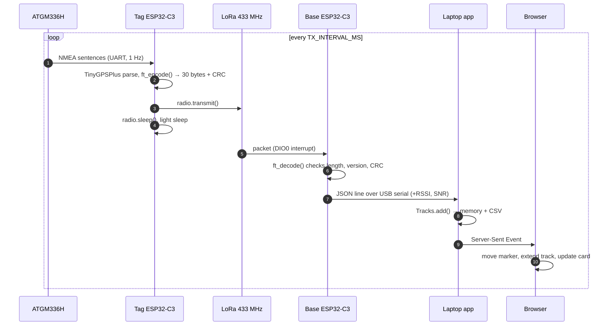
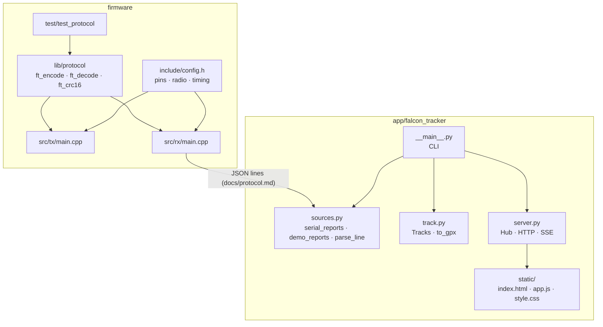

# Architecture

## Data flow



## Components



## Design decisions

| Decision | Why | Alternative considered |
|---|---|---|
| One PlatformIO project, two envs | Shared pins, radio settings and codec cannot drift | Two separate projects |
| Fixed 30-byte binary frame | Short airtime = battery + duty cycle + range | JSON/CSV text over LoRa (~6× longer) |
| Base station decodes and prints JSON | Any tool can consume it; app has no binary parsing | Base forwards raw bytes |
| RadioLib | Mature, supports SX127x well, interrupt RX | sandeepmistry/LoRa (unmaintained) |
| Light sleep, not deep sleep | Keeps RAM and the UART; simple loop | Deep sleep (lower µA, but re-init every cycle) |
| Python stdlib server + SSE | One dependency (pyserial), works offline, easy to read | Flask/FastAPI + WebSocket |
| Leaflet + OSM/Esri tiles | Free, no API key | Google Maps (key, billing) |

## Knowledge graph (graphify)

`graphify-out/` holds a knowledge graph of this repository built with
[graphify](https://pypi.org/project/graphifyy/): every module, function and
document becomes a node, and calls/imports/references become edges.

| File | Use |
|---|---|
| `graphify-out/graph.html` | Open in a browser: interactive, searchable graph |
| `graphify-out/GRAPH_REPORT.md` | Communities, central nodes ("god nodes"), surprising links |
| `graphify-out/graph.json` | Raw graph for tools and AI assistants |

Rebuild it after changing code:

```bash
pip install graphifyy
graphify update .
```

AI coding assistants (Claude Code, Cursor, …) can read `GRAPH_REPORT.md` to find
their way around the codebase quickly instead of reading every file. See also
[CLAUDE.md](../CLAUDE.md).
