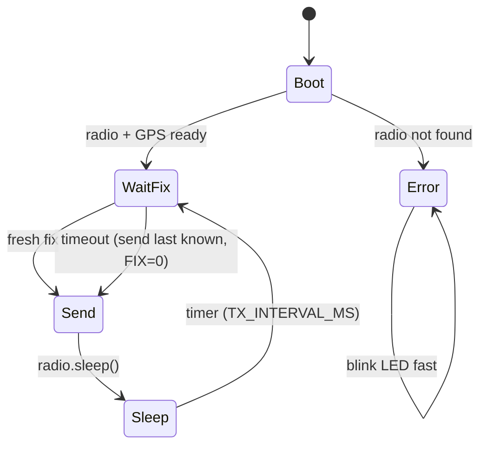

# Firmware

One PlatformIO project builds both boards. They share the pin map, radio settings
and the packet codec, so they cannot drift apart.

```
firmware/
├── platformio.ini       envs: tx, rx, native
├── include/config.h     everything you might want to change
├── lib/protocol/        ft_encode / ft_decode / ft_crc16 (plain C, unit tested)
├── src/tx/main.cpp      falcon tag
├── src/rx/main.cpp      base station
└── test/test_protocol/  runs on your PC: pio test -e native
```

## Build and flash

```bash
cd firmware
pio run                     # build both
pio run -e tx -t upload     # flash the tag
pio run -e rx -t upload     # flash the base
pio device monitor          # 115200 baud
pio test -e native          # protocol tests on the PC (needs gcc)
```

If the upload does not start, hold **BOOT**, tap **RESET**, release **BOOT**, and
upload again. This forces the ESP32-C3 into download mode (needed after the tag
has been light-sleeping, because USB is off during sleep).

Arduino IDE users: open `src/tx/main.cpp` as a sketch, copy in `config.h` and the
`protocol` files, and install RadioLib 7.1.2 and TinyGPSPlus 1.1.0 from the
library manager. Board: *ESP32C3 Dev Module*, *USB CDC On Boot: Enabled*.

## Configuration

All in [`include/config.h`](../firmware/include/config.h). The ones you will most
likely touch, also settable per environment with `-D` in `platformio.ini`:

| Macro | Default | Meaning |
|---|---|---|
| `DEVICE_ID` | 1 | Unique per tag. Shown as "Falcon N" in the app. |
| `TX_INTERVAL_MS` | 5000 | Time between reports. Longer = more battery. |
| `GPS_EN_PIN` | -1 | Set to 1 if you fitted the GPS power MOSFET. |
| `LORA_FREQ_MHZ` | 433.775 | Must match on both boards and your regulations. |
| `LORA_SF` | 9 | 7 = fast/short range, 12 = slow/long range. |
| `LORA_TX_DBM` | 17 | Output power, 2–17 dBm. |
| `LOW_BATT_MV` | 3500 | Below this the app shows the battery in red. |

Example: a second tag that reports every minute with the GPS switch fitted:

```ini
[env:tx2]
extends = env:tx
build_flags = ${esp32c3.build_flags} -D DEVICE_ID=2 -D TX_INTERVAL_MS=60000 -D GPS_EN_PIN=1
```

## How the tag works



1. **Wait for a fresh fix.** NMEA is fed into TinyGPSPlus until a position newer
   than the previous report arrives (normally within 1 s, because the GPS outputs
   once per second). In power-save mode the GPS is switched on first and the wait
   can last up to `GPS_FIX_TIMEOUT_MS`.
2. **Build and send** the 30-byte frame (`ft_encode`). `radio.transmit()` blocks
   for the ~284 ms airtime. The blue LED is on while transmitting.
3. **Sleep.** The SX1278 goes to sleep (~1 µA) and the ESP32-C3 light-sleeps until
   the next period. Light sleep keeps RAM, so the sequence number and the last
   known position survive, and the GPS keeps tracking (unless switched off).

The cycle is timed from its start, so reports stay on a steady rhythm regardless
of how long the fix took.

## How the base works

The SX1278 stays in continuous receive. DIO0 raises an interrupt when a packet
arrives; the main loop reads it, validates it with `ft_decode` and prints one JSON
line with RSSI and SNR (see [protocol.md](protocol.md)). The LED blinks for every
good packet.

## LED codes

| Pattern | Meaning |
|---|---|
| On at boot, then off | Starting up |
| Short blink every interval (tag) | Transmitting |
| Short blink per packet (base) | Good packet received |
| Fast blinking forever | Radio not found: check SPI wiring, 3V3 and NSS/RESET |
